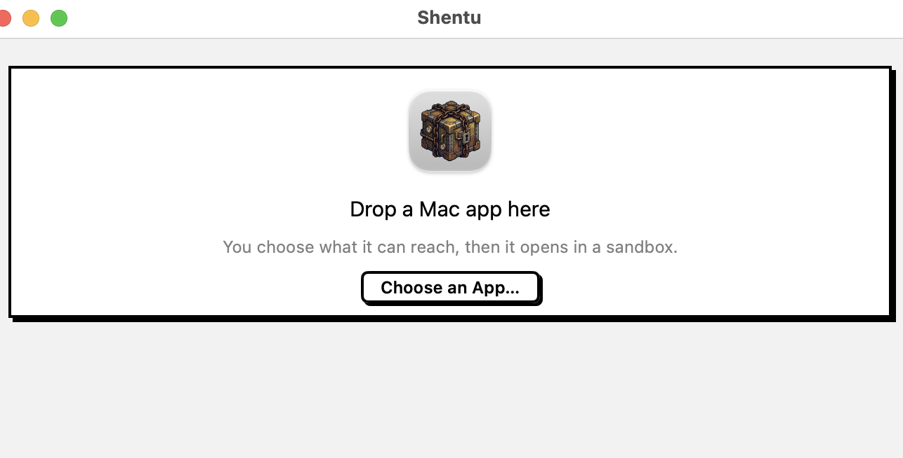
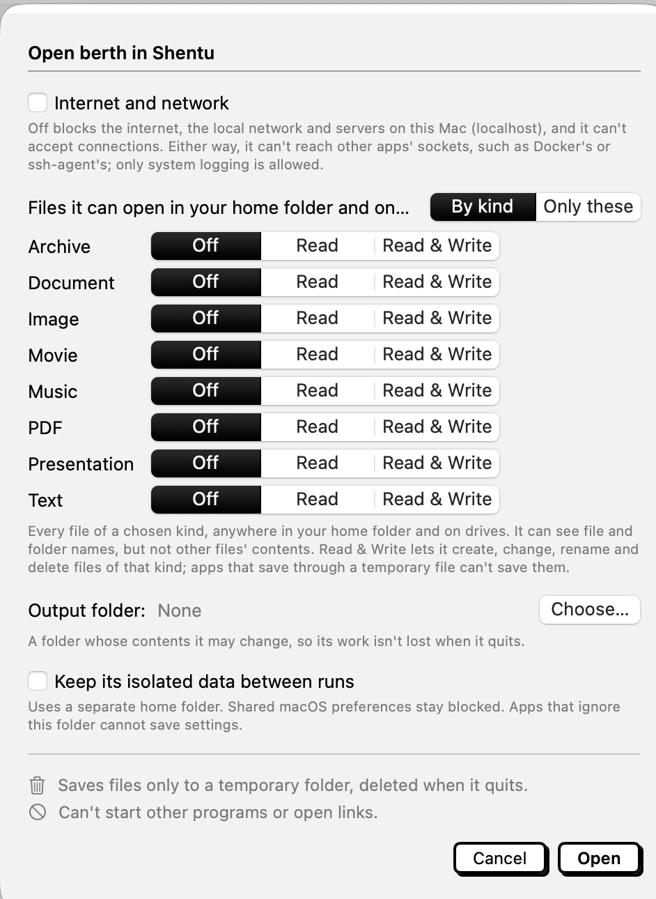
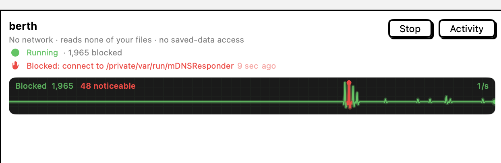

# Shentu

Drop a Mac app on Shentu and it opens in a strongly isolated (seatbelt) sandbox.

## What you choose

**Internet and network.** Off means no internet or local-network connections.

**Files it can open — by kind.** Archive, Document, Image, Movie, Music, PDF, Presentation and Text (Finder's Kind names), each set to Off, Read, or Read & Write. Hover a name for its extensions.

- Read opens every file of that kind in your home folder and on drives (`/Volumes`).
- Read & Write also lets it create, change, rename and delete files of that kind there, and nowhere else.
- Apps that save through a temporary file with another name (NSDocument's safe save) can't save them.
- It can see file and folder names. System files and the app itself are always readable.
- Code, scripts and Finder's other kinds (Application, Executable, Other) aren't offered.

**Files it can open — only these.** Just the files and folders you pick, read-only (a folder includes everything inside it). Less access than a kind, which opens every matching file you have.

**Output folder.** Optional. One folder it can read, change and delete anything in, so its work survives the run. It must be inside your home folder or on a drive, and can't be your whole home folder, a whole drive, `~/Library`, or a protected place. Checked again at every launch.

## While it runs

Each run shows its state, how many requests were blocked, the latest one you'd notice, and a pulse of blocks over time. Stop ends the app and everything it started; Activity lists what it was blocked from.

